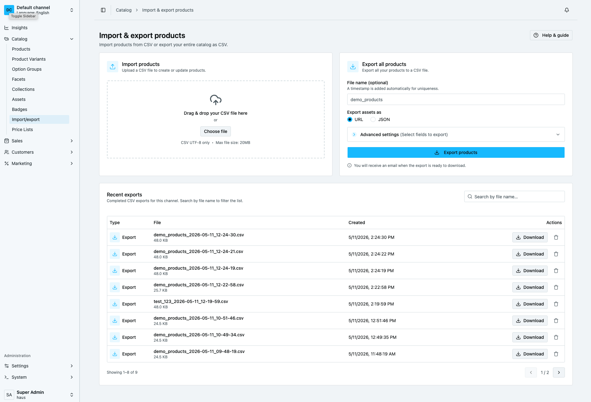
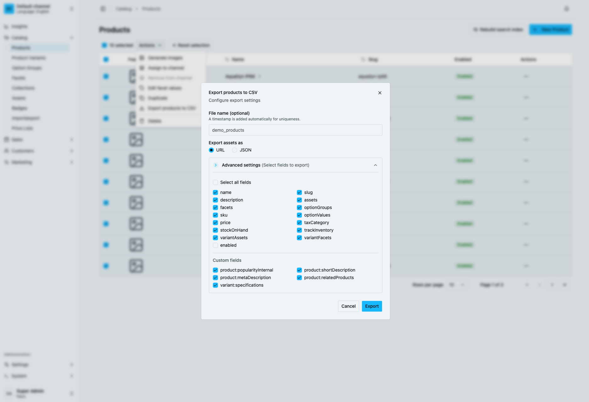

# Product Import Export Plugin

A Vendure plugin for importing and exporting product data via CSV. Supports bulk product management and data migration between environments.

## Features

- **Import** – Bulk upload products from CSV with validation, custom fields, assets, facets, and variants
- **Export** – Export products to CSV with selected fields; export all products or a selection
- **Storage strategies** – Store exported files in S3 or locally on disk (with automatic fallback)
- **UI** – Admin UI and Dashboard integration for import and export



## Compatibility

Vendure **^3.6.0**

## Getting started

```bash
npm install @haus-tech/product-import-export-plugin
```

## Configuration

Add the plugin to your Vendure configuration.

```typescript
export const config = {
  plugins: [
    ProductImportExportPlugin.init({
      importOptions: {}, // Configure import options
      exportOptions: {
        storageStrategy: 's3', // 's3' | 'disk'
        s3Options: {
          bucket: 'your-bucket',
          region: 'your-region',
          credentials: {
            accessKeyId: '...',
            secretAccessKey: '...',
          },
        },
      },
    }),
  ],
}
```

## Configuration Options

### Import options

| Option                   | Type                                               | Default     | Description                                                                                                                |
| ------------------------ | -------------------------------------------------- | ----------- | -------------------------------------------------------------------------------------------------------------------------- |
| `updateProductSlug`      | `boolean`                                          | `true`      | Update product slug from the `name` field in the CSV                                                                       |
| `restoreSoftDeleted`     | `boolean`                                          | `true`      | Restore soft-deleted products/variants found by id or SKU during import. If `false`, new products will be created instead. |
| `storageStrategy`        | `ImportJobStorageStrategy`                         | local disk  | Strategy instance for queued import file storage and retrieval.                                                            |
| `storageStrategyFactory` | `(injector: Injector) => ImportJobStorageStrategy` | `undefined` | Factory for DI-aware strategy creation (recommended for S3/remote storage).                                                |
| `importJobStorage`       | `'local' \| 's3'`                                  | `'local'`   | Deprecated compatibility flag. Prefer `storageStrategy` / `storageStrategyFactory`.                                        |
| `rowValidationStrategy`  | `ImportRowValidationStrategy`                      | accepts all | Checks the rows of a file before anything is written. See [Row validation](#row-validation).                               |

Available import storage strategies:

- `LocalImportJobStorageStrategy` (default)
- `S3ImportJobStorageStrategy`

### Export options

| Option                  | Type                  | Default                 | Description                                                  |
| ----------------------- | --------------------- | ----------------------- | ------------------------------------------------------------ |
| `defaultFileName`       | `string`              | `'products_export.csv'` | Default filename for exports                                 |
| `exportAssetsAsOptions` | `('url' \| 'json')[]` | `['url', 'json']`       | Available formats for asset export                           |
| `defaultExportAssetsAs` | `'url' \| 'json'`     | `'url'`                 | Default asset export format                                  |
| `defaultExportFields`   | `string[]`            | See above               | Fields that will be pre-selected in the export UI            |
| `requiredExportFields`  | `string[]`            | `['name', 'sku']`       | Fields that must always be included                          |
| `customExportColumns`   | `CustomExportColumn[]`| `undefined`             | Extra CSV columns resolved per variant row. See [Custom export columns](#custom-export-columns) below. |
| `relationLookups`       | `Record<string, string>` | `undefined`          | Relation custom fields written by a column of the related row instead of its id. See [Exporting relations by a column](#exporting-relations-by-a-column) below. |
| `storageStrategy`       | `'s3' \| 'disk'`      | `'disk'`                | Where exported files are stored                              |
| `s3Options`             | `object`              | `undefined`             | S3 configuration (required when `storageStrategy` is `'s3'`) |

### Storage strategy

The plugin supports configurable storage for exported files:

- **S3** – Stores export files in an S3-compatible bucket
- **Disk (default)** – Saves files locally on the server

### Row validation

`importOptions.rowValidationStrategy` lets you reject rows by your own rules. It runs on the parsed file twice:

1. At upload, before the file is stored. If it returns errors, the upload answers `400` with `{ "errors": [...] }` and nothing is queued.
2. When the import job starts, before anything is written, since data can change while the job waits. If it returns errors, the job fails with the same list and nothing is imported.

Each error is shown as `Row <line>: <message>`, in one list with the [relation lookup](#relations-by-sku-or-another-column) errors, ordered by row. Line 1 is the header; blank and comma-only lines are not counted. Numbers count CSV records, so a quoted cell that spans several lines is still one row.

A job that fails this way ends in the `FAILED` state with the list as its error, instead of `COMPLETED` with the errors in its result. The same holds when a relation lookup no longer matches when the job runs.

```typescript
import {
  ImportRowError,
  ImportRowGroup,
  ImportRowValidationStrategy,
} from '@haus-tech/product-import-export-plugin'
import { Injector, RequestContext, TransactionalConnection } from '@vendure/core'

class NoLabelOnSampleStrategy implements ImportRowValidationStrategy {
  private connection!: TransactionalConnection

  init(injector: Injector) {
    this.connection = injector.get(TransactionalConnection)
  }

  async validate(ctx: RequestContext, rows: ImportRowGroup[]): Promise<ImportRowError[]> {
    return rows
      .filter((row) => row.product.customFields.labelId !== undefined)
      .filter((row) => row.variants.some(({ variant }) => variant.sku.startsWith('SAMPLE-')))
      .map((row) => ({ line: row.line, message: 'a sample product cannot have a label' }))
  }
}

ProductImportExportPlugin.init({
  importOptions: { rowValidationStrategy: new NoLabelOnSampleStrategy() },
  exportOptions: {},
})
```

Each `ImportRowGroup` is one product: its first row (`line`, `product`) and every variant row under it (`variants[].line`, `variants[].variant`).

- Relation custom fields are keyed by their Admin API input name (`labelId`, `labelsIds`) and hold id strings, also when the file names the related rows by a lookup column such as `:sku` or `:code`. An empty cell, and a value a lookup could not resolve, is left out.
- An `Asset` relation keeps its cell text under the field name, since assets are created only when the row is written. Other custom fields keep their cell text under the field name.
- `product.productId` is set when the product's first row has a product id in the first column, that is when the row updates an existing product by id. Without it, the importer matches existing products by variant SKU.
- `product.customFields` holds the custom fields of the product's first translation, which include every non-localised field; each entry of `product.translations` has its own.
- The groups are copies: changing them does not change what is imported.

`init(injector)` and `destroy()` are called when the application starts and stops. The default strategy accepts every row.

If `validate` throws, the upload answers `500` and nothing is queued, and a running job fails with the thrown error. Return errors instead to show them by row.

Lookup columns must be plain text columns of the related entity, so a translated field (for example a collection's `name`, which lives on its translation entity) cannot be one. The strategy does not run when a lookup header is wrong, since no row is read then.

### Custom export columns

Add columns to the exported CSV whose value is computed per variant row, for example a permalink built from the product slug and variant SKU.

```typescript
export const config = {
  plugins: [
    ProductImportExportPlugin.init({
      importOptions: {},
      exportOptions: {
        customExportColumns: [
          {
            name: 'permalink',
            onExportStart: () => {
              // Optional. Runs once per export job, before the first resolve() call.
              // Use it to reset any per-export cache or counter.
            },
            resolve: (ctx, injector, product, variant) =>
              `https://shop.example.com/${product.slug}?sku=${variant.sku}`,
          },
        ],
      },
    }),
  ],
}
```

- **`name`** – Must be non-empty, must not contain `:` (colon-suffixed headers are reserved for translated columns), must not collide with a built-in export field name, and must be unique among `customExportColumns` entries. These rules are validated when the plugin is initialised, so a misconfigured column fails fast at startup rather than mid-export.
- **`onExportStart`** – Optional. Awaited once per export job, before the first `resolve` call.
- **`resolve(ctx, injector, product, variant)`** – Called once per exported variant row. Its return value is written to the cell (`String(value)`, or an empty cell for `null`/`undefined`). Use `injector` to pull in Vendure services via DI.
- A custom column only appears in the export when its `name` is included in the selected export fields, both in the header row and in the request; otherwise it is skipped entirely.
- **Fail-soft** – If `resolve` throws, the plugin logs a warning and writes an empty cell for that row instead of failing the whole export.

## CSV Format for Import

### Required columns

- `name` – Product name (use `name:en`, `name:sv` etc. for multiple languages)
- `sku` – Variant SKU (unique per variant)

### Optional columns

| Column                        | Format                                                                                                                             | Example                                                                                    |
| ----------------------------- | ---------------------------------------------------------------------------------------------------------------------------------- | ------------------------------------------------------------------------------------------ |
| `name`, `slug`, `description` | Text, or `name:en`, `name:sv` for translations                                                                                     | `My Product`                                                                               |
| `assets`                      | Pipe-separated URLs or existing asset sources, or JSON `[{"id":1,"url":"...","name":"..."}]`                                       | `https://example.com/1.jpg\|source/b6/2.jpg`                                               |
| `channels`                    | Channel tokens, pipe-separated (see [Assigning products to channels](#assigning-products-to-channels))                            | `club-a\|club-b`                                                                          |
| `facets`                      | `facet:value` pairs, pipe-separated                                                                                                | `Brand:Acme\|Category:Electronics`                                                         |
| `optionGroups`                | Pipe-separated group names. Use `name:code` to share a group across products (see [Sharing option groups](#sharing-option-groups)) | `Size\|Color` or `size:shoe-size`                                                          |
| `optionValues`                | Pipe-separated values (order matches option groups)                                                                                | `Large\|Blue`                                                                              |
| `price`                       | Number (in smallest currency unit)                                                                                                 | `9999`                                                                                     |
| `taxCategory`                 | Tax category name                                                                                                                  | `standard`                                                                                 |
| `stockOnHand`                 | Number                                                                                                                             | `100`                                                                                      |
| `trackInventory`              | `true` or `false`                                                                                                                  | `true`                                                                                     |
| `variantAssets`               | Same format as `assets`                                                                                                            | `https://example.com/variant.jpg`                                                          |
| `variantFacets`               | Same format as `facets`                                                                                                            | `Material:Cotton`                                                                          |
| `enabled`                     | `true` or `false`                                                                                                                  | `true`                                                                                     |
| Custom fields                 | Column name = custom field name; value depends on field type                                                                       | Add columns for any Product or ProductVariant custom fields defined in your Vendure config. Relation custom fields export the related entity's id (`id\|id` for list fields), including fields that relate a product or variant to its own entity type. |

#### Import behavior rules

- If a column is omitted from the CSV header, that field is left unchanged on existing products/variants.
- If a column exists in the header but the cell is empty, that field is explicitly cleared.
- For products with more than one variant, `optionGroups` and `optionValues` are required.
- The header is checked before the upload is queued. A custom field column the shop does not have, a missing required column or mixed translated and untranslated columns make the upload answer `400` with `{ "errors": ["Invalid custom field: product:clubName"] }`, the Dashboard lists the errors, and nothing is imported.
- Product data (`slug`, `description`, `assets`, `channels`, `facets`, `optionGroups` and `product:` custom fields) is read from a product's first row, the row with a `name`. If a later variant row of the product fills one of these columns, that product is not imported and the import reports the column and line. Other products in the file still import. `id` may repeat on every row.
- An asset value that is not a URL names an existing asset the way the export writes it: by the JSON `id`, otherwise by its `source`. It is linked without being uploaded again, so an unchanged export imports with every image kept, also with **replace**. A value that matches no asset is reported as an error. A URL is downloaded unless an asset with the same file name exists.

#### Assigning products to channels

A product is always assigned to the default channel and to the channel the import runs in. The `channels` column assigns it to more channels, named by token, so one file run from the default channel can fill several channels:

```csv
name,sku,price,channels
Club Tee,CLUB-TEE-M,299,club-a
Shared Cap,CAP-1,199,club-a|club-b
```

- The product and its variants are assigned, each variant with a price row in each channel's currency, and so are the option groups and facets the row writes. A shared option group (`name:code`) keeps the channels it has; Vendure reads a product's option groups whatever their channels. A variant added to the product later in the file gets the same channels.
- The column only adds. An empty cell or a file without the column leaves a product in the channels it is in; remove a product from a channel in the Admin UI or Dashboard.
- The upload is checked before it is queued, and the job checks again before its first write. Any problem answers `400` with the rows and nothing is imported:
  - `Row 3: channels: no channel with token 'club-x'`
  - `Row 2: channels: no right to update products in channel 'club-b'`: the uploader needs `UpdateCatalog` or `UpdateProduct` in every channel the file names.
  - `Row 2: channels: an import run in channel 'club-a' can only name 'club-a', not 'club-b'`: outside the default channel, a file can only name the channel it runs in.
- Server code that calls `ProductImporter` with a context without a user is trusted, so it is not checked for rights; the token and channel rules still apply.
- The export writes the column (select `channels`): from the default channel the product's other channels, by channel id; from another channel only that channel's token, so a club's file never shows which other channels sell the product. An exported file imports again.

#### Relations by SKU or another column

A relation custom field can name the related row by one of its columns instead of by id. Add the column as a fourth segment to the header, after the type (the related entity's class name in lower case):

```csv
name,sku,price,variant:baseVariant:productvariant:sku,product:label:productlabel:code
Club Tee,CLUB-TEE-M,299,BASE-TEE-M,ECO
```

- The column must be a text column of the related entity (not a relation or custom field). Otherwise the upload answers `400` with `{ "errors": ["Invalid lookup column \"title\" on ProductLabel"] }`.
- Each value must match exactly one row of the related entity, in any channel. Rows with a `deletedAt` are skipped. Matching is exact, so case and spacing count. A list field takes `VALUE|VALUE`.
- The upload is checked before it is queued. If a value matches no row or more than one, the upload answers `400` with the rows, for example `Row 2: no ProductLabel with code ECO` or `Row 3: code ECO matches 2 ProductLabel rows`. `:sku` on a relation to `ProductVariant` keeps its own wording: `Row 2: no variant with SKU BASE-TEE-M` and `Row 3: SKU BASE-TEE-M matches 2 variants`. The Dashboard lists the rows and nothing is imported. The import job checks again when it runs; if a value no longer matches exactly one row, the job fails with the same list and nothing is imported.
- The related rows must exist before the upload, so import them in an earlier file.
- The third segment must be the related entity's class name (`productvariant`, `productlabel`; case does not matter), and a field takes one lookup column. Otherwise the upload answers `400` and names the column. `:sku` on a relation to `ProductVariant` accepts any third segment, as it always has.
- A lookup works only on relation custom fields. Columns without a fourth segment still take ids.

#### Exporting relations by a column

The export writes relation custom fields as ids unless `exportOptions.relationLookups` names a column for the field. Keys are `<owner>:<field>`, values the column of the related entity:

```ts
ProductImportExportPlugin.init({
  importOptions: {},
  exportOptions: {
    relationLookups: {
      'variant:baseVariant': 'sku',
      'product:label': 'code',
    },
  },
})
```

- The export then writes the field under the lookup header (`variant:baseVariant:productvariant:sku`, `product:label:productlabel:code`) with the related rows' values, `VALUE|VALUE` for a list field. The import reads that header as described above, so the file imports again, also into another database where the ids differ.
- The column must be a plain text column of the related entity, and the field must be a relation custom field that does not relate to `Asset`. Otherwise the application does not start and the error names the key.
- A related row that is soft-deleted, or has no value in the column, is left out of the cell, since the import matches only live rows by a value. Values must be unique among live rows: a value two live rows share makes the import of the file fail with the lookup error above.

#### Sharing option groups

By default, each product gets its own option groups. To **share an option group** across
multiple products (e.g. a common "Size" group for all shoes), use the `name:code` syntax in the
`optionGroups` column: `size:shoe-size`. All products that reference the same code will share
a single option group. Products using a plain name (e.g. just `size`) will each get their own
independent option group.

```csv
...optionGroups     , optionValues , ...
# Each shoe product shares a single "shoe-size" option group:
"size:shoe-size"    , Small        , ...
"size:shoe-size"    , Medium       , ...
# This product gets its own independent "size" group:
"size"              , 4GB          , ...
```

The first product to reference a given code defines the full set of option values for that
shared group; subsequent products may use any subset of those values. Codes are language-
agnostic — only the `name` portion before the colon is translated per language column
(`optionGroups:en`, `optionGroups:sv`, etc.).

#### Multi-language support

Use language-specific columns by suffixing the field name with the language code. The language codes must match those configured in your Vendure instance (e.g. `en`, `sv`).

| Column pattern           | Example columns        | Use case                                         |
| ------------------------ | ---------------------- | ------------------------------------------------ |
| `name:en`, `name:sv`     | Product name per lang  | Translated product names                         |
| `slug:en`, `slug:sv`     | Slug per lang          | Translated URLs                                  |
| `description:en`         | Description per lang   | Translated descriptions                          |
| `facets:en`, `facets:sv` | Facets per lang        | Translated facet names and values                |
| `optionGroups:en`        | Option groups per lang | Translated option group names (e.g. Size, Color) |
| `optionValues:en`        | Option values per lang | Translated option values (e.g. Large, Blue)      |

Example CSV with English and Swedish:

```csv
name:en,name:sv,sku,facets:en,facets:sv
"Red Shirt","Röd tröja",SHIRT-001,"Color:Red|Size:Large","Färg:Röd|Storlek:Stor"
```

#### Multiple values (pipe separator)

Fields that can have multiple values use the pipe character `|` as a separator:

- **Facets**: `Brand:Acme|Category:Electronics`
- **Option groups**: `Size|Color`
- **Option values**: `Large|Blue` (order matches option groups)
- **Assets**: `https://example.com/1.jpg|https://example.com/2.jpg`

## Usage

:::note
The Admin UI offers basic import and export. Some features such as the export-all option and the list of exported files are only available in the Dashboard. New features will be added to the Dashboard only.
:::

### Importing products

1. Create a CSV with the columns above.
2. Go to the Admin UI or Dashboard and open the Product Import section.
3. Upload the CSV and choose options (update slugs, restore soft-deleted, main language).
4. Select the update strategy: **merge** (keep existing facets/assets) or **replace** (overwrite).
5. Start the import.

### Exporting products

1. In the Admin UI or Dashboard, select products to export (or use bulk export).
2. Configure export fields (assets, facets, custom fields, etc.).
   - For products with more than one variant, `optionGroups` and `optionValues` must be included.
   - `channels` is available as a selectable export field (see [Assigning products to channels](#assigning-products-to-channels)).
   - `id` (the Vendure product id) is available as a selectable export field. It is written after the translated `name`/`slug`/`description` columns, so it is never CSV column 0, since import treats column 0 positionally as a product id for by-id matching.
   - If `customExportColumns` is configured, only the columns whose `name` is selected are written to the CSV.
   - The job reports progress per page; the Dashboard job queue shows it.
   - `productId` is not available as a selectable export field.
   - If `customFields` are not selected, no custom-field columns are written to the CSV.
   - Product custom-field columns come after the other product columns (`name` through `facets`) and before `optionGroups`, which is the last product column so it sits next to `optionValues`, the first variant column. Product custom fields are filled on a product's first row only. Import reads product data from that row, so edit product fields there.
3. Choose asset format: URL or JSON.
4. Start the export (it is added to a job queue and runs in the background).
5. Download the CSV when the export is complete. Your downloaded files will be listed in the export view.



## Optional: Email notification on export complete

If you use `@vendure/email-plugin`, you can add an email notification when an export finishes from the `/email` subpath.

The plugin now provides a default fallback template for `product-export-complete/body.hbs`.  
If you define your own template in your app's template directory, your template takes precedence.
Note: templates for `@vendure/email-plugin` should be valid MJML.

```typescript
import path from 'path'
import {
  DefaultEmailPlugin,
  FileBasedTemplateLoader,
  defaultEmailHandlers,
} from '@vendure/email-plugin'
import {
  withProductExportedHandler,
  withProductExportedTemplateFallback,
} from '@haus-tech/product-import-export-plugin/email'

export const config = {
  plugins: [
    DefaultEmailPlugin.init({
      handlers: withProductExportedHandler(defaultEmailHandlers),
      templateLoader: withProductExportedTemplateFallback(
        new FileBasedTemplateLoader(path.join(__dirname, '../static/email/templates')),
      ),
    }),
  ],
}
```

## Resources

- [Vendure Plugin Documentation](https://docs.vendure.io/guides/developer-guide/plugins/)
- [Vendure Import/Export Guide](https://docs.vendure.io/guides/developer-guide/importing-data/)
